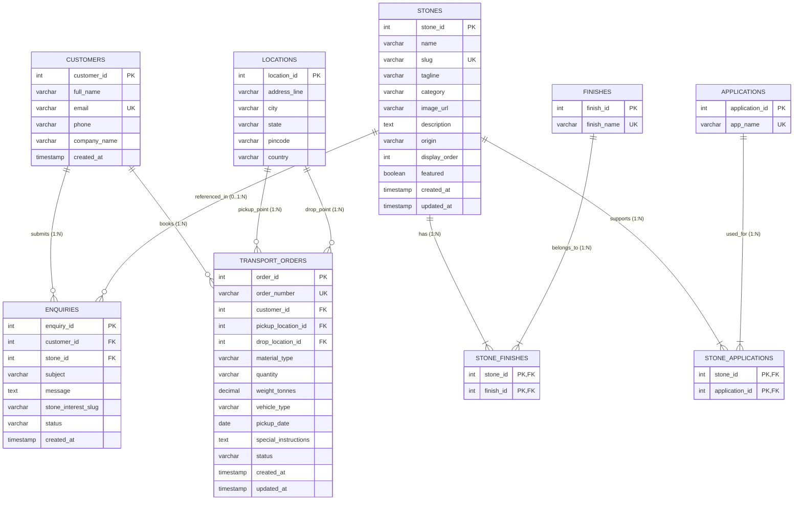

# Database Design, ER Diagrams & Normalization (RDBMS Schema)

**Project:** Jammu Makrana Transport & Komal Minerals Supplier  
**Stack:** MERN Platform (MongoDB, Express, React, Node) with Enterprise RDBMS Relational Mapping (PostgreSQL / MySQL compatible)

---

## 1. Entity-Relationship (ER) Diagram (Chen's Notation)


> **Image & Vector Links (Chen's Notation):**
> - [High-Resolution Chen ER Diagram (PNG)](image/chen_er_diagram.png)
> - [Scalable Vector Chen ER Diagram (SVG)](image/chen_er_diagram.svg)
> - [Interactive Web Viewer](image/index.html)

---

## 2. Physical RDBMS Schema & Relational Table Diagram


> **Vector & Image Links (RDBMS Physical Schema):**
> - [High-Resolution Relational Schema (PNG)](image/database_er_diagram.png)
> - [Scalable Vector Relational Schema (SVG)](image/database_er_diagram.svg)

---

## 2. Interactive Mermaid Entity-Relationship Diagram



---

## 3. Relational Database (RDBMS) Table Specifications

### 3.1. `customers` Table
Stores normalized personal and company contact profiles to avoid duplication across bookings and inquiries.

| Column | Data Type | Nullable | Key / Index | Default | Description |
| :--- | :--- | :---: | :---: | :--- | :--- |
| `customer_id` | `INT` / `BIGINT` | No | **PK** | `AUTO_INCREMENT` | Unique primary key |
| `full_name` | `VARCHAR(120)` | No | | None | Customer / Representative name |
| `email` | `VARCHAR(150)` | No | **UQ** | None | Unique customer email address |
| `phone` | `VARCHAR(20)` | No | **INDEX** | None | Primary contact mobile/telephone |
| `company_name` | `VARCHAR(120)` | Yes | | `NULL` | Business or firm trade name |
| `created_at` | `TIMESTAMP` | No | | `CURRENT_TIMESTAMP` | Profile creation timestamp |

```sql
CREATE TABLE customers (
    customer_id INT AUTO_INCREMENT PRIMARY KEY,
    full_name VARCHAR(120) NOT NULL,
    email VARCHAR(150) NOT NULL UNIQUE,
    phone VARCHAR(20) NOT NULL,
    company_name VARCHAR(120) DEFAULT NULL,
    created_at TIMESTAMP DEFAULT CURRENT_TIMESTAMP
);
```

---

### 3.2. `locations` (Addresses) Table
Normalizes origin and destination geographic endpoints to eliminate transitive dependencies and redundant city/state text.

| Column | Data Type | Nullable | Key / Index | Default | Description |
| :--- | :--- | :---: | :---: | :--- | :--- |
| `location_id` | `INT` | No | **PK** | `AUTO_INCREMENT` | Unique address identity |
| `address_line` | `VARCHAR(300)` | No | | None | Street, factory, or warehouse address |
| `city` | `VARCHAR(100)` | No | **INDEX** | None | City name (e.g. Makrana, Jammu) |
| `state` | `VARCHAR(100)` | No | **INDEX** | None | State / Province |
| `pincode` | `VARCHAR(10)` | Yes | | `NULL` | Postal PIN code |
| `country` | `VARCHAR(60)` | No | | `'India'` | Country designation |

```sql
CREATE TABLE locations (
    location_id INT AUTO_INCREMENT PRIMARY KEY,
    address_line VARCHAR(300) NOT NULL,
    city VARCHAR(100) NOT NULL,
    state VARCHAR(100) NOT NULL,
    pincode VARCHAR(10) DEFAULT NULL,
    country VARCHAR(60) NOT NULL DEFAULT 'India'
);
```

---

### 3.3. `stones` (Catalog) Table
Product catalogue entities for natural stones (marble, granite, limestone) and minerals.

| Column | Data Type | Nullable | Key / Index | Default | Description |
| :--- | :--- | :---: | :---: | :--- | :--- |
| `stone_id` | `INT` | No | **PK** | `AUTO_INCREMENT` | Surrogate primary key |
| `name` | `VARCHAR(150)` | No | | None | Stone trade name (e.g., Makrana White) |
| `slug` | `VARCHAR(100)` | No | **UQ, INDEX** | None | URL-safe SEO identifier |
| `tagline` | `VARCHAR(255)` | Yes | | `'Komal Minerals'` | Brief descriptive subtitle |
| `category` | `VARCHAR(80)` | No | **INDEX** | `'Natural Stone'` | Classification category |
| `image_url` | `VARCHAR(300)` | No | | None | Relative path to asset CDN |
| `description` | `TEXT` | Yes | | `NULL` | Mineral composition & details |
| `origin` | `VARCHAR(100)` | No | | `'India'` | Quarry geographical origin |
| `display_order`| `INT` | No | | `0` | Catalogue sorting priority |
| `featured` | `BOOLEAN` | No | **INDEX** | `FALSE` | Featured on homepage |
| `created_at` | `TIMESTAMP` | No | | `CURRENT_TIMESTAMP` | Record creation timestamp |
| `updated_at` | `TIMESTAMP` | No | | `CURRENT_TIMESTAMP ON UPDATE CURRENT_TIMESTAMP` | Last updated timestamp |

```sql
CREATE TABLE stones (
    stone_id INT AUTO_INCREMENT PRIMARY KEY,
    name VARCHAR(150) NOT NULL,
    slug VARCHAR(100) NOT NULL UNIQUE,
    tagline VARCHAR(255) DEFAULT 'Komal Minerals Supplier',
    category VARCHAR(80) NOT NULL DEFAULT 'Natural Stone',
    image_url VARCHAR(300) NOT NULL,
    description TEXT,
    origin VARCHAR(100) NOT NULL DEFAULT 'India',
    display_order INT NOT NULL DEFAULT 0,
    featured BOOLEAN NOT NULL DEFAULT FALSE,
    created_at TIMESTAMP DEFAULT CURRENT_TIMESTAMP,
    updated_at TIMESTAMP DEFAULT CURRENT_TIMESTAMP ON UPDATE CURRENT_TIMESTAMP
);
```

---

### 3.4. `finishes` & `stone_finishes` (Many-to-Many Decomposition for 1NF)
Normalizes array field `finishes: [String]` into first normal form.

```sql
CREATE TABLE finishes (
    finish_id INT AUTO_INCREMENT PRIMARY KEY,
    finish_name VARCHAR(60) NOT NULL UNIQUE
);

CREATE TABLE stone_finishes (
    stone_id INT NOT NULL,
    finish_id INT NOT NULL,
    PRIMARY KEY (stone_id, finish_id),
    FOREIGN KEY (stone_id) REFERENCES stones(stone_id) ON DELETE CASCADE,
    FOREIGN KEY (finish_id) REFERENCES finishes(finish_id) ON DELETE RESTRICT
);
```

---

### 3.5. `applications` & `stone_applications` (Many-to-Many Decomposition for 1NF)
Normalizes array field `applications: [String]` into first normal form.

```sql
CREATE TABLE applications (
    application_id INT AUTO_INCREMENT PRIMARY KEY,
    app_name VARCHAR(100) NOT NULL UNIQUE
);

CREATE TABLE stone_applications (
    stone_id INT NOT NULL,
    application_id INT NOT NULL,
    PRIMARY KEY (stone_id, application_id),
    FOREIGN KEY (stone_id) REFERENCES stones(stone_id) ON DELETE CASCADE,
    FOREIGN KEY (application_id) REFERENCES applications(application_id) ON DELETE RESTRICT
);
```

---

### 3.6. `transport_orders` Table
Freight logistics bookings generated by `Transportation.jsx` and processed by `api/routes/orders.js`.

| Column | Data Type | Nullable | Key / Index | Default | Description |
| :--- | :--- | :---: | :---: | :--- | :--- |
| `order_id` | `INT` | No | **PK** | `AUTO_INCREMENT` | Internal order primary key |
| `order_number` | `VARCHAR(50)` | No | **UQ, INDEX** | None | Business consignment identifier (`JMT-XXXX-XXXX`) |
| `customer_id` | `INT` | No | **FK** | None | References `customers(customer_id)` |
| `pickup_location_id` | `INT` | No | **FK** | None | References `locations(location_id)` |
| `drop_location_id` | `INT` | No | **FK** | None | References `locations(location_id)` |
| `material_type` | `VARCHAR(100)` | No | | None | Mineral/stone freight payload |
| `quantity` | `VARCHAR(100)` | No | | None | Quantity / batch count |
| `weight_tonnes` | `DECIMAL(10,2)`| Yes | | `NULL` | Numerical consignment weight |
| `vehicle_type` | `VARCHAR(100)` | No | | None | Required fleet vehicle |
| `pickup_date` | `DATE` | No | | None | Scheduled pickup date |
| `special_instructions`| `TEXT` | Yes | | `NULL` | Custom delivery notes |
| `status` | `ENUM` | No | **INDEX** | `'new'` | `('new','confirmed','in_transit','completed','cancelled')` |
| `created_at` | `TIMESTAMP` | No | | `CURRENT_TIMESTAMP` | Order timestamp |
| `updated_at` | `TIMESTAMP` | No | | `CURRENT_TIMESTAMP ON UPDATE CURRENT_TIMESTAMP` | Last updated timestamp |

```sql
CREATE TABLE transport_orders (
    order_id INT AUTO_INCREMENT PRIMARY KEY,
    order_number VARCHAR(50) NOT NULL UNIQUE,
    customer_id INT NOT NULL,
    pickup_location_id INT NOT NULL,
    drop_location_id INT NOT NULL,
    material_type VARCHAR(100) NOT NULL,
    quantity VARCHAR(100) NOT NULL,
    weight_tonnes DECIMAL(10,2) DEFAULT NULL,
    vehicle_type VARCHAR(100) NOT NULL,
    pickup_date DATE NOT NULL,
    special_instructions TEXT DEFAULT NULL,
    status ENUM('new','confirmed','in_transit','completed','cancelled') NOT NULL DEFAULT 'new',
    created_at TIMESTAMP DEFAULT CURRENT_TIMESTAMP,
    updated_at TIMESTAMP DEFAULT CURRENT_TIMESTAMP ON UPDATE CURRENT_TIMESTAMP,
    FOREIGN KEY (customer_id) REFERENCES customers(customer_id) ON DELETE RESTRICT,
    FOREIGN KEY (pickup_location_id) REFERENCES locations(location_id) ON DELETE RESTRICT,
    FOREIGN KEY (drop_location_id) REFERENCES locations(location_id) ON DELETE RESTRICT
);
```

---

### 3.7. `enquiries` Table
Customer contact messages and quotes generated via `Contact.jsx` or detail pages.

| Column | Data Type | Nullable | Key / Index | Default | Description |
| :--- | :--- | :---: | :---: | :--- | :--- |
| `enquiry_id` | `INT` | No | **PK** | `AUTO_INCREMENT` | Unique inquiry identity |
| `customer_id` | `INT` | No | **FK** | None | References `customers(customer_id)` |
| `stone_id` | `INT` | Yes | **FK** | `NULL` | Optional reference to `stones(stone_id)` |
| `subject` | `VARCHAR(200)` | No | | None | Subject headline |
| `message` | `TEXT` | No | | None | Detailed message / quote inquiry |
| `stone_interest_slug` | `VARCHAR(100)` | Yes | | `NULL` | Stone slug visitor was viewing |
| `status` | `ENUM` | No | **INDEX** | `'new'` | `('new','contacted','closed')` |
| `created_at` | `TIMESTAMP` | No | | `CURRENT_TIMESTAMP` | Submission timestamp |

```sql
CREATE TABLE enquiries (
    enquiry_id INT AUTO_INCREMENT PRIMARY KEY,
    customer_id INT NOT NULL,
    stone_id INT DEFAULT NULL,
    subject VARCHAR(200) NOT NULL,
    message TEXT NOT NULL,
    stone_interest_slug VARCHAR(100) DEFAULT NULL,
    status ENUM('new','contacted','closed') NOT NULL DEFAULT 'new',
    created_at TIMESTAMP DEFAULT CURRENT_TIMESTAMP,
    FOREIGN KEY (customer_id) REFERENCES customers(customer_id) ON DELETE CASCADE,
    FOREIGN KEY (stone_id) REFERENCES stones(stone_id) ON DELETE SET NULL
);
```

---

## 4. Normalization Analysis Matrix (Show NF in Table)

The following table comprehensively details the transformation of the system data model from an **Unnormalized Form (UNF)** to **1NF, 2NF, 3NF, and BCNF**, proving the elimination of data anomalies:

| Normal Form (NF) | Formal Requirement | Issues in Prior Form | Normalization Actions Taken | Resulting Relational Tables | Anomalies Eliminated |
| :--- | :--- | :--- | :--- | :--- | :--- |
| **UNF (Unnormalized)** | Flat structure with non-atomic attributes, embedded documents, and multi-valued arrays. | NoSQL arrays (`finishes: ['Polished','Honed']`, `applications: ['Flooring','Countertops']`); duplicated customer data embedded in every order & enquiry. | Raw JSON / document structure analyzed into constituent entity candidate schemas. | 1 large document collection per business action. | Redundant data, infinite duplicate customer records, data inconsistency. |
| **1NF (First Normal Form)** | Every column must contain **atomic (indivisible) values**; each record must have a unique Primary Key (PK); no repeating groups. | `finishes` and `applications` in `stones` violated 1NF because multiple values were packed into a single field. | Extracted multi-valued arrays into discrete child lookup tables (`finishes`, `applications`) linked via composite-key junction tables (`stone_finishes`, `stone_applications`). | - `stones`<br>- `finishes`<br>- `stone_finishes`<br>- `applications`<br>- `stone_applications` | **Update Anomaly:** Modifying a finish name no longer requires scanning and updating arrays in multiple stone records. |
| **2NF (Second Normal Form)** | Must be in 1NF **AND** all non-key attributes must be **fully functionally dependent** on the complete Primary Key (no partial dependencies). | In composite primary key relations (e.g. `(stone_id, finish_id)`), storing attributes like `finish_description` or `stone_name` would depend on only part of the primary key. | Removed all non-key descriptive attributes from composite junction tables. `stone_finishes` and `stone_applications` contain *only* the composite foreign keys `(stone_id, finish_id)` and `(stone_id, application_id)`. | - `stone_finishes (stone_id, finish_id)`<br>- `stone_applications (stone_id, application_id)` | **Insertion Anomaly:** A new finish can be created in `finishes` without requiring an existing stone to be associated with it. |
| **3NF (Third Normal Form)** | Must be in 2NF **AND** no non-prime attribute may depend transitively on the primary key (**no transitive dependencies**: $X \rightarrow Y \rightarrow Z$). | In `orders` and `enquiries`, customer details (`fullName`, `email`, `phone`, `companyName`) and addresses (`pickupCity`, `dropCity`, `state`) were stored directly. Since `email -> (fullName, phone)` and `pincode -> (city, state)`, transitive dependencies existed ($order\_id \rightarrow email \rightarrow fullName$). | 1. Extracted customer profile into `customers` table with `customer_id` PK.<br>2. Extracted address coordinates into `locations` table with `location_id` PK.<br>3. `transport_orders` and `enquiries` retain foreign keys (`customer_id`, `pickup_location_id`, `drop_location_id`). | - `customers`<br>- `locations`<br>- `transport_orders`<br>- `enquiries` | **Deletion Anomaly:** Deleting a cancelled order does NOT erase the customer's contact record or past inquiry history.<br>**Update Anomaly:** When a customer updates their phone number, it updates in 1 single record in `customers`. |
| **BCNF (Boyce-Codd Normal Form)** | Must be in 3NF **AND** for every non-trivial functional dependency $X \rightarrow Y$, the determinant $X$ must be a **superkey / candidate key**. | If multiple candidate keys exist, attributes could depend on parts of candidate keys. | Verified across all relations: In `customers`, `customer_id` and `email` are candidate keys. In `stones`, `stone_id` and `slug` are candidate keys. In `transport_orders`, `order_id` and `order_number` are candidate keys. Every determinant is a candidate key. | All tables are in full BCNF compliance. | Complete absence of non-key determinants causing redundancy. |

---

## 5. Candidate Keys, Functional Dependencies & BCNF Validation Table


The following table formally proves that every determinant $X$ in the non-trivial functional dependencies ($X \rightarrow Y$) is a **Superkey**, verifying that all tables achieve **Boyce-Codd Normal Form (BCNF)**:

| Table Name | Candidate Key(s) | Functional Dependencies ($X \rightarrow Y$) | Determinant $X$: $X$ is Superkey? | Normal Form Achieved |
| :--- | :--- | :--- | :---: | :---: |
| **`CUSTOMERS`** | `{customer_id}`,<br>`{Email}` | `customer_id` $\rightarrow$ `{Name, Contact_Number, Email, Address, City}`<br>`Email` $\rightarrow$ `{customer_id, Name, Contact_Number, Address, City}` | :white_check_mark: **Yes** (`customer_id` / `Email`) | **BCNF** |
| **`ORDERS`** | `{Order_Id}` | `Order_Id` $\rightarrow$ `{Customer_Id, Location_Id, Order_Date, Estimated_Delivery}` | :white_check_mark: **Yes** (`Order_Id`) | **BCNF** |
| **`STONES`** | `{Stone_Id}` | `Stone_Id` $\rightarrow$ `{Stone_Name, Stock_Quantity, Description, Finish, Color}` | :white_check_mark: **Yes** (`Stone_Id`) | **BCNF** |
| **`ENQUIRIES`** | `{Enquiry_Id}` | `Enquiry_Id` $\rightarrow$ `{Customer_Id, Stone_Id, Enquiry_Date, Message, Is_converted}` | :white_check_mark: **Yes** (`Enquiry_Id`) | **BCNF** |
| **`ORDER_STONES`** | `{(Order_Id, Stone_Id)}` | `{Order_Id, Stone_Id}` $\rightarrow$ `{Quantity}` | :white_check_mark: **Yes** (Composite Key) | **BCNF** |
| **`LOCATION`** | `{Location_Id}` | `Location_Id` $\rightarrow$ `{Address, City, State, Pincode, Country}` | :white_check_mark: **Yes** (`Location_Id`) | **BCNF** |

---

## 6. MERN (MongoDB) vs. Relational (RDBMS) Mapping

| MERN MongoDB / Mongoose Collection | Schema File | Relational RDBMS Equivalent Tables | Primary Motivation for Normalization |
| :--- | :--- | :--- | :--- |
| `Stone` | [`api/models/Stone.js`](file:///c:/Users/chand/Desktop/Project/api/models/Stone.js) | `stones`, `finishes`, `stone_finishes`, `applications`, `stone_applications` | Array decomposition into 1NF; prevents re-writing string arrays; enables indexable SQL filtering across finishes and architectural applications. |
| `Order` | [`api/models/Order.js`](file:///c:/Users/chand/Desktop/Project/api/models/Order.js) | `transport_orders`, `customers`, `locations` | Eliminates redundant customer contact and shipping city/state strings; enforces foreign key referential integrity; prevents data loss upon order deletion. |
| `Enquiry` | [`api/models/Enquiry.js`](file:///c:/Users/chand/Desktop/Project/api/models/Enquiry.js) | `enquiries`, `customers`, `stones` | Unifies lead management across contact forms and product detail quote requests; links directly to customer identity and stone inventory records. |
| Offline Fallback Seed | [`api/data/stones.js`](file:///c:/Users/chand/Desktop/Project/api/data/stones.js) | Seed SQL Migration Script (`seed.sql`) | Pre-loads standard Makrana marbles and mineral catalogue items with idempotent upserts (`ON DUPLICATE KEY UPDATE`). |
